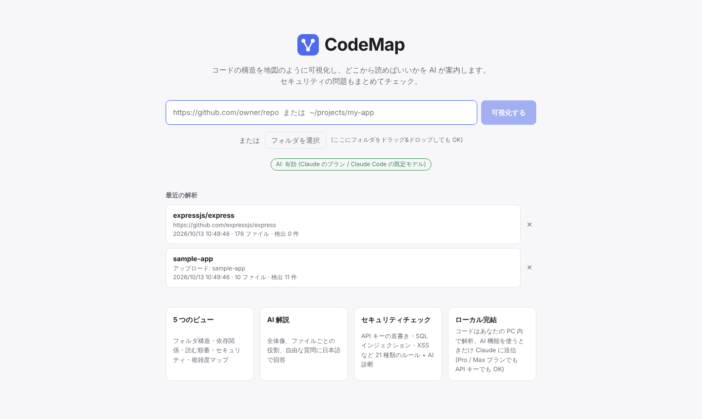
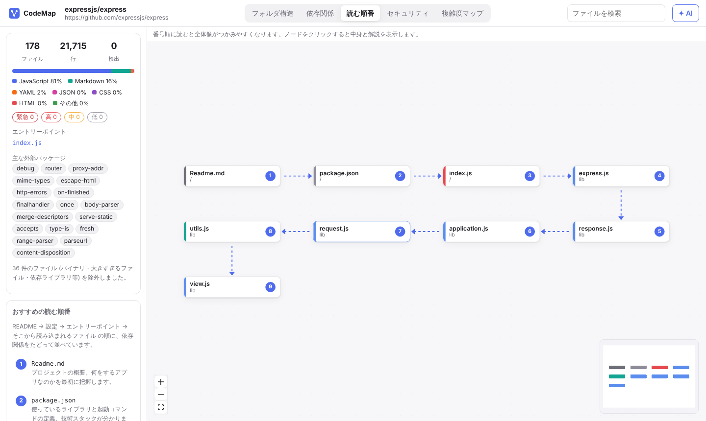
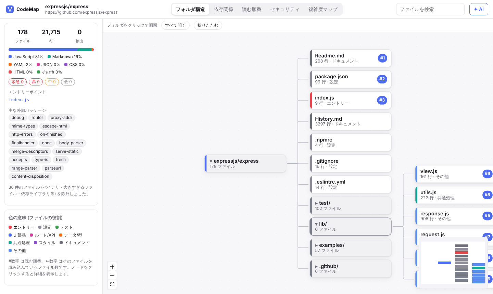
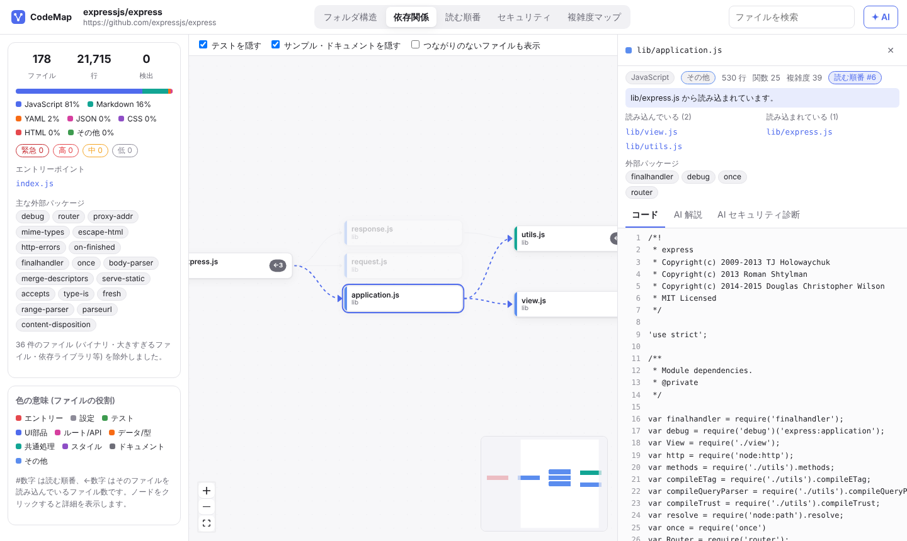
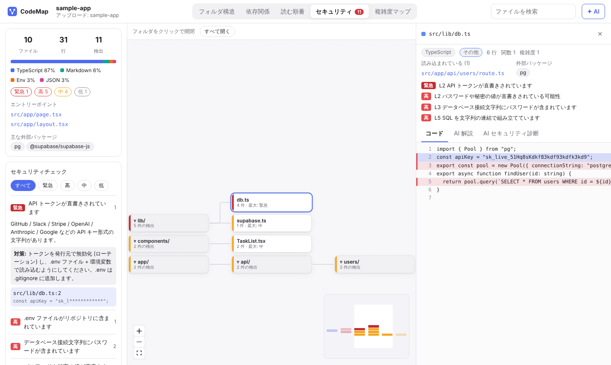
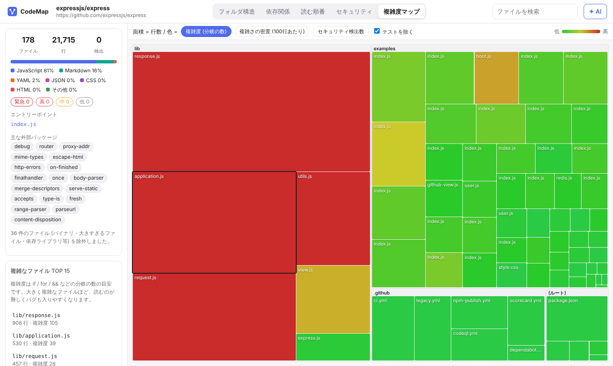
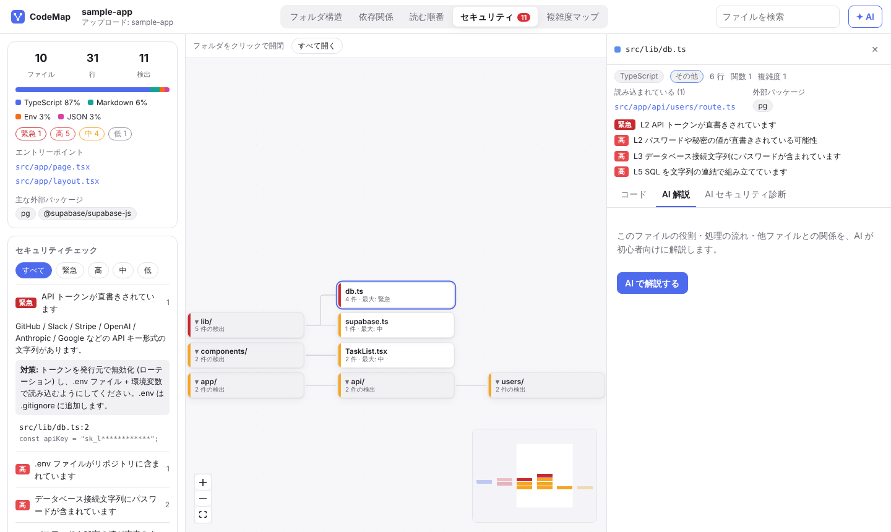
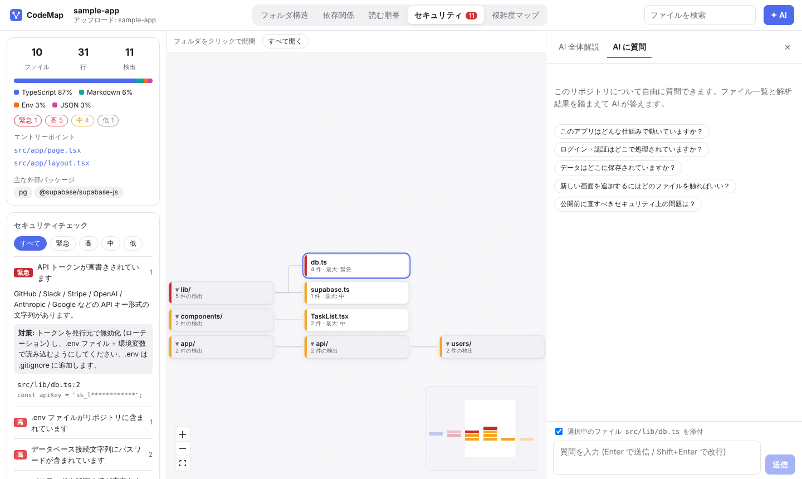

# CodeMap の使い方

CodeMap は、知らないコード (AI に書いてもらったコード・他人のリポジトリ・昔の自分のプロジェクト) を **短時間で理解するための道具** です。
このガイドでは、インストールから、画面の見方、おすすめの使い方までを順番に説明します。

- [1. 準備する](#1-準備する)
- [2. 起動する](#2-起動する)
- [3. コードを読み込む](#3-コードを読み込む)
- [4. 画面の見方](#4-画面の見方)
- [5. 5 つのビューを使い分ける](#5-5-つのビューを使い分ける)
- [6. ファイルの詳細を見る](#6-ファイルの詳細を見る)
- [7. AI に解説してもらう・質問する](#7-ai-に解説してもらう質問する)
- [8. セキュリティチェックの結果を読む](#8-セキュリティチェックの結果を読む)
- [9. おすすめの使い方 (目的別)](#9-おすすめの使い方-目的別)
- [10. 設定](#10-設定)
- [11. 困ったときは](#11-困ったときは)

---

## 1. 準備する

| 必要なもの | 用途 | 確認方法 |
| --- | --- | --- |
| Node.js 20 以上 | CodeMap 本体を動かす | `node -v` |
| git | GitHub のリポジトリを取得する | `git --version` |
| Claude の Pro / Max プラン + Claude Code (任意) | AI 解説・質問機能 | `claude --version` |
| または Claude API キー (任意) | AI 解説・質問機能 (従量課金) | [Claude Console](https://console.anthropic.com/) で発行 |

AI 機能を設定しなくても、**可視化 (5 つのビュー) とセキュリティチェックはすべて使えます**。AI 機能だけが無効になります。

初回だけ、依存パッケージのインストールと画面のビルドを行います。

```bash
cd code-visualize
npm install
npm run build
```

### AI 機能を設定する

AI 機能は次の 2 通りのどちらかで使えます。**Claude の Pro / Max プランを契約しているなら A がおすすめ** です。

| | A. Claude のプランで使う | B. API キーで使う |
| --- | --- | --- |
| 必要なもの | Pro / Max プラン + Claude Code | Claude API キー |
| 料金 | プランの料金内 (追加料金なし) | 使った分だけ従量課金 |
| 上限 | プランの利用枠 (claude.ai・Claude Code と共通) | API の利用上限・残高 |
| 仕組み | CodeMap が裏で `claude -p` を呼び出す | CodeMap が Claude API を直接呼び出す |

#### A. Claude のプラン (Pro / Max) で使う

1. Claude Code をインストールします (すでに使っているなら不要)。

   ```bash
   npm install -g @anthropic-ai/claude-code
   ```

2. ターミナルで `claude` を起動し、`/login` で **Claude アカウント (Pro / Max プランのアカウント)** にログインします。ログインできたら `/exit` で終了します。

3. そのまま `npm start` で CodeMap を起動します。API キーを設定していなければ、自動でこの方式になります。

起動時のターミナルに次のように表示されれば準備完了です。

```
  AI: Claude Code 経由 (Claude のプランの利用枠) / モデル: Claude Code の既定モデル
```

> CodeMap が Claude Code を呼び出すときは、ファイル操作やコマンド実行などのツールをすべて無効にし、解説用の指示だけを与えて動かします。CodeMap 経由で Claude Code が PC の中を勝手に操作することはありません。

#### B. API キーで使う

`.env.example` をコピーして `.env` を作り、キーを書き込みます。

```bash
cp .env.example .env
```

```ini
# .env
ANTHROPIC_API_KEY=sk-ant-xxxxxxxxxxxx
```

`.env` は `.gitignore` に入っているので、誤ってコミットされることはありません。

API キーが設定されていると **B が優先** されます。キーを残したままプランで使いたい場合は、`.env` に `CODEMAP_AI=subscription` と書いてください。

## 2. 起動する

```bash
npm start
```

ターミナルに次のように表示されたら、ブラウザで **http://127.0.0.1:5178** を開きます。

```
CodeMap サーバー起動: http://127.0.0.1:5178  (model: claude-opus-5-5)
```

終了するときはターミナルで `Ctrl + C` を押します。

> CodeMap 自体を改造する場合は `npm run dev` で起動すると、コードを保存するたびに画面が自動で更新されます (http://127.0.0.1:5173)。

## 3. コードを読み込む



トップ画面から、次の 3 つの方法で読み込めます。

### A. GitHub の URL を入力する

入力欄に URL を貼り付けて **「可視化する」** を押します。

| 入力例 | 意味 |
| --- | --- |
| `https://github.com/expressjs/express` | リポジトリ全体 (既定ブランチ) |
| `https://github.com/vercel/next.js/tree/canary/packages/next` | ブランチ `canary` の `packages/next` フォルダだけ |
| `expressjs/express` | `owner/repo` の省略形 |

- 最新の状態だけを取得する (`git clone --depth 1`) ので、大きなリポジトリでも比較的速く読み込めます。
- **非公開リポジトリ** を読み込むには、`.env` に `GITHUB_TOKEN` (repo の読み取り権限があるトークン) を設定してください。

### B. ローカルフォルダのパスを入力する

自分の PC にあるプロジェクトは、フォルダのパスを入力します。

```
~/projects/my-app
/Users/me/work/todo-app
```

`~` はホームフォルダに置き換えられます。相対パスは `npm start` を実行したフォルダが基準です。

### C. フォルダを選択する / ドラッグ&ドロップする

**「フォルダを選択」** ボタンを押すか、フォルダを画面にドラッグ&ドロップします。
パスを調べるのが面倒なときに便利です。

### 自動で除外されるもの

解析を速く・見やすくするため、次のものは読み込みません。

- `node_modules/`、`.git/`、`dist/`、`build/`、`.next/`、`venv/` などの依存ライブラリ・生成物のフォルダ
- `package-lock.json` などのロックファイル、`*.min.js`、ソースマップ
- 画像などのバイナリファイル、400KB を超えるファイル
- 上限 (4,000 ファイル / 合計 60MB) を超えた分

除外した件数は、解析後の画面左上の概要カードに表示されます。

### 履歴から開く

一度解析したものは **「最近の解析」** に残ります (最大 30 件)。クリックすると、再解析せずにすぐ開けます。
不要になったものは右端の **✕** で削除できます。

解析結果の画面の URL (`http://127.0.0.1:5178/#/a/...`) をブックマークしておけば、次回もそのまま開けます。

## 4. 画面の見方



| 場所 | 内容 |
| --- | --- |
| 上部・中央 | **ビュー切り替え** (フォルダ構造 / 依存関係 / 読む順番 / セキュリティ / 複雑度マップ) |
| 上部・右 | **ファイル検索** (名前の一部を入力 → 候補をクリックで、そのファイルへ移動) と **✦ AI** ボタン |
| 左サイドバー | 概要 (ファイル数・行数・言語の割合・検出件数・エントリーポイント・主な外部パッケージ) と、ビューごとのリスト |
| 中央 | マップ。ドラッグで移動、ホイールで拡大縮小、左下のボタンで全体表示 |
| 右パネル | ファイルをクリックすると詳細が開く。✦ AI を押すと AI パネルが開く |

左上の **CodeMap** ロゴを押すとトップ画面に戻ります。

### ノードの色と印

ノード左端の色は **ファイルの役割** を表します。

| 色 | 役割 | 例 |
| --- | --- | --- |
| 赤 | エントリー (起動地点) | `main.tsx`, `index.js`, `main.py` |
| 青 | UI 部品 | `*.tsx`, `components/` |
| ピンク | ルート / API | `routes/`, `api/`, `route.ts` |
| オレンジ | データ / 型 | `models/`, `types.ts`, `schema.prisma` |
| 緑青 | 共通処理 | `utils/`, `helpers/`, `hooks/` |
| 緑 | テスト | `*.test.ts`, `tests/` |
| 灰 | 設定・ドキュメント | `package.json`, `README.md` |
| 水色 | その他 | 上のどれにも当てはまらないファイル |

右端の印の意味:

- **#3** … 読む順番の 3 番目
- **←5** … 5 つのファイルから読み込まれている (依存関係ビュー)。数字が大きいほど重要な「中核ファイル」
- **⚠** … セキュリティチェックで問題が見つかったファイル

## 5. 5 つのビューを使い分ける

### 読む順番 — まずここから

最初に開くのはこのビューです。**番号の順に読むと、全体像をつかみやすい順番** になっています。

順番は次のルールで自動的に決まります。

1. **README** … 何をするプロジェクトかを把握する
2. **package.json などの設定** … 使っている技術と起動方法が分かる
3. **エントリーポイント** … アプリが起動したとき最初に動くファイル
4. **エントリーポイントから読み込まれているファイル** … 依存関係を浅い順にたどる。同じ深さなら、多くのファイルから使われている中核ファイルを先にする
5. **API の入り口** (Next.js の `route.ts` など) と、**多くのファイルから参照されている中核ファイル**

テストや `examples/`・`docs/` 内のサンプルコードは、本体を理解するのに後回しでよいので除外しています (最大 30 ステップ)。

左サイドバーには、各ステップを **なぜ読むのか** の理由付きで一覧表示します。

### フォルダ構造 — どこに何があるか



フォルダとファイルの階層をツリーで表示します。

- **フォルダをクリック** すると開閉します (▸ が閉じている、▾ が開いている)
- 大きなリポジトリでは、見やすいように最初は浅い階層だけ開いています
- 上部の **「すべて開く」「折りたたむ」** で一括操作できます
- 各ノードに行数と役割が表示されるので、「巨大なファイル」「役割の分からないファイル」を見つけやすくなります

### 依存関係 — ファイル同士のつながり



矢印は **「A → B = A が B を読み込んでいる (import している)」** を表します。左から右へ、呼び出す側から呼ばれる側へ並びます。

- **ファイルをクリック** すると、そのファイルに直接つながるファイルだけが強調され、それ以外は薄くなります。「このファイルを変更したら、どこに影響するか」を調べるのに便利です
- 上部のチェックボックス:
  - **テストを隠す** (既定: オン)
  - **サンプル・ドキュメントを隠す** (既定: オン) … `examples/`, `docs/` など
  - **つながりのないファイルも表示** (既定: オフ) … どこからも読み込まれず、何も読み込まないファイル
- ファイルが非常に多い場合は、つながりの多い上位 350 ファイルだけを表示します

### セキュリティ — 問題がどこにあるか



問題が見つかったファイルとそのフォルダだけをツリーで表示し、**最も深刻な問題の危険度で色分け** します (濃い赤 = 緊急、赤 = 高、黄 = 中、灰 = 低)。
フォルダの色は中に含まれる最も深刻な問題の色なので、「どのフォルダが危ないか」がひと目で分かります。

左サイドバーの使い方は [8. セキュリティチェックの結果を読む](#8-セキュリティチェックの結果を読む) を参照してください。

### 複雑度マップ — 読みにくい場所はどこか



ファイルを四角形で敷き詰めた図 (ツリーマップ) です。

- **面積 = 行数** (大きいほど長いファイル)
- **色 = 選んだ指標** (緑 → 黄 → 赤 の順に高い)。上部のボタンで切り替えます:
  - **複雑度 (分岐の数)** … `if` / `for` / `&&` / `case` などの数。多いほど処理の分かれ道が多く、読むのもテストするのも大変
  - **複雑さの密度 (100 行あたり)** … 短いのにやたら複雑な「濃い」ファイルが分かる
  - **セキュリティ検出数**
- 外側の枠は最上位のフォルダです
- マウスを乗せると行数・関数の数・複雑度が表示され、クリックするとファイル詳細が開きます
- **テストを除く** (既定: オン) でテストファイルを表示から外せます

左サイドバーには **複雑なファイル TOP 15** が表示されます。大きくて赤いファイルは、リファクタリングやテスト追加を優先すべき候補です。

## 6. ファイルの詳細を見る

どのビューでもファイルをクリックすると、右側に詳細パネルが開きます。

| 項目 | 内容 |
| --- | --- |
| 上部の情報 | 言語・役割・行数・関数の数・複雑度・読む順番の番号 |
| 青い帯 | 読む順番に入っている場合、その理由 |
| 読み込んでいる / 読み込まれている | 関係するファイルの一覧。クリックでそのファイルへ移動 |
| 外部パッケージ | このファイルが使っているライブラリ (npm / pip など) |
| 検出結果 | このファイルのセキュリティ問題。クリックでその行へジャンプ |
| タブ | **コード** / **AI 解説** / **AI セキュリティ診断** |

**コード** タブでは、問題が見つかった行が危険度の色で強調されます。強調された行にマウスを乗せると、問題の内容と対策が表示されます。

## 7. AI に解説してもらう・質問する

AI 機能を使うには、[AI 機能の設定](#ai-機能を設定する) が必要です。使えるかどうかは、トップ画面の **「AI: 有効 (Claude のプラン / …)」** の表示で確認できます。

### ファイルを解説してもらう



ファイル詳細の **「AI 解説」** タブ → **「AI で解説する」** を押すと、次の内容を初心者向けの日本語で解説します。

1. このファイルの役割
2. 主な関数・クラス・コンポーネントの説明
3. 処理の流れ
4. 他のファイルとの関係
5. 読むときのポイント・注意点

回答は少しずつ表示されます。途中で止めたいときは **「停止」**、作り直したいときは **「再生成」** を押します。
回答中の `src/lib/db.ts` のようなファイル名はクリックするとそのファイルが開きます。

### リポジトリ全体を解説してもらう

右上の **✦ AI** → **「AI 全体解説」** タブ → **「AI で全体を解説する」** を押します。
README と読む順番の上位ファイルを AI が読み、次の内容をまとめます。

- ひとことで言うと何をするプロジェクトか
- 技術スタック (言語・フレームワーク・ライブラリとその役割)
- 全体の構造と処理の流れ
- おすすめの読む順番と、各ファイルで注目すべきポイント
- 気をつける点

初めてのリポジトリでは、**読む順番ビューを見る → AI 全体解説を読む** の順にすると理解が早くなります。

### 質問する (チャット)



**✦ AI** → **「AI に質問」** タブで、リポジトリについて自由に質問できます。
AI はファイル一覧・依存関係・読む順番・セキュリティ検出結果を踏まえて答えます。

- **Enter** で送信、**Shift + Enter** で改行
- ファイルを選択した状態で **「選択中のファイル ○○ を添付」** にチェックを入れると、そのファイルの中身も読んだうえで答えます
- 最初は質問例ボタンから始めると便利です

質問の例:

- 「ログイン処理はどこにありますか？」
- 「ユーザーが『保存』を押したとき、データはどのファイルを通ってどこに保存されますか？」
- 「新しい API を追加するには、どのファイルを真似すればいいですか？」
- 「`useEffect` が何回も呼ばれているのはなぜですか？」 (ファイルを添付して)
- 「このアプリを公開する前に直すべきことを優先度順に教えて」

**「会話をリセット」** で会話を最初からやり直せます。

### AI 機能の注意点

- AI の回答は、ページを開いている間だけ保持されます。ブラウザを再読み込みすると消えます
- **AI 機能のボタンを押したときだけ**、コードの一部が Anthropic (Claude) に送信されます (全体解説: README と主要ファイル / ファイル解説: そのファイルと import 先の冒頭 / チャット: ファイル一覧と、添付したファイル)。それ以外の解析はすべて PC 内で完結します
- **プラン (A) で使う場合**: 追加料金はかかりませんが、claude.ai や Claude Code と **同じ利用枠** を消費します。全体解説やセキュリティ診断は大きめのファイルを読むので、枠を多めに使います。上限に達すると「Claude プランの利用上限に達しました」と表示されるので、表示された時刻以降に再試行してください
- **API キー (B) で使う場合**: 使った分だけ料金がかかります。既定のモデル (`claude-opus-5-5`) は高性能な分だけ料金も高めです
- どちらの場合も、[10. 設定](#10-設定) の `CODEMAP_MODEL` で軽いモデル (`sonnet` や `haiku` など) に変えると、速く・枠や料金を節約できます
- AI も間違えることがあります。重要な判断の前には、該当するコードを自分の目でも確認してください

## 8. セキュリティチェックの結果を読む

解析すると、すべてのファイルに対して 21 種類のルールで自動チェックが行われます (AI は使いません)。

### 危険度の目安

| 危険度 | 意味 | 対応 |
| --- | --- | --- |
| **緊急** | 秘密鍵・API キーなどが漏れている | 今すぐキーを無効化 (ローテーション) し、コードから削除 |
| **高** | 攻撃されると被害が大きい (SQL インジェクション、.env のコミットなど) | 公開・デプロイ前に必ず修正 |
| **中** | 条件によっては危険 (XSS、CORS の全許可など) | 内容を確認して修正を検討 |
| **低** | 念のため確認 (http:// 通信、セキュリティ関連の TODO) | 余裕があれば対応 |

### 確認の手順

1. **セキュリティ** ビューを開く (タブの赤い数字が検出件数)
2. 左サイドバー上部のボタンで危険度を絞り込む (例: まず **緊急** と **高** だけ)
3. ルール名をクリックすると、**何が問題か** と **対策** が表示される
4. その下の `ファイル名:行番号` をクリックすると、該当行がハイライトされた状態でコードが開く
5. 本当に問題か判断がつかないときは、**AI セキュリティ診断** タブで診断してもらう

> 表示されるコードの抜粋では、秘密情報らしき値は `sk_l********` のように伏せ字になります。

### AI セキュリティ診断

ファイル詳細の **「AI セキュリティ診断」** タブ → **「AI でセキュリティ診断する」** を押すと、AI が次の内容を返します。

- 総合評価 (問題なし / 要注意 / 危険)
- 自動チェックの各検出が **本当に問題か、誤検知か** の判定
- 自動チェックでは見つけにくい問題 (認証・権限チェックの抜け、入力値の検証不足、CSRF など)
- 問題ごとの **修正後のコード例**

自動チェックは決まったパターンを探すだけなので、「検出 0 件 = 安全」ではありません。
ログイン・決済・個人情報を扱うファイル (API のルートなど) は、検出がなくても AI 診断をかけておくと安心です。

### 誤検知を消す

意図的な書き方で、問題ないと判断した行は、行末にコメントで `codemap-ignore` と書くと次回から検出されなくなります。

```ts
el.innerHTML = trustedTemplate; // codemap-ignore (固定の HTML なので安全)
```

ファイル全体を対象外にするときは、ファイル内のどこかに `codemap-ignore-file` と書きます。

## 9. おすすめの使い方 (目的別)

### AI に作ってもらったアプリを理解したい

1. プロジェクトフォルダを読み込む
2. **読む順番** ビューで全体の流れを眺める
3. **✦ AI → AI 全体解説** で、何がどこにあるかの説明を読む
4. 番号順にファイルを開き、分からないファイルは **AI 解説** を読む
5. 疑問が出たら **AI に質問** (例:「このボタンを押すと何が起きる？」)

### 公開・デプロイ前にチェックしたい

1. **セキュリティ** ビューで **緊急・高** をゼロにする
2. API・認証・データベースを扱うファイルに **AI セキュリティ診断** をかける
3. **AI に質問** で「公開前に直すべきことを優先度順に教えて」と聞く
4. 修正したら、トップ画面から同じフォルダを読み込み直して再チェック

### OSS や他人のリポジトリを読みたい

1. GitHub の URL を貼って読み込む (巨大なモノレポは `/tree/main/packages/xxx` のように範囲を絞る)
2. **読む順番** と **AI 全体解説** で入口を把握
3. 気になる機能はファイル検索で探し、**依存関係** ビューでクリックして関係ファイルをたどる

### リファクタリングの優先順位を決めたい

1. **複雑度マップ** で「大きくて赤い」ファイルを探す
2. **依存関係** ビューで、そのファイルが何ファイルから使われているか (←数字) を確認する。多いほど変更の影響範囲が広い
3. **AI に質問**:「`src/xxx.ts` を分割するならどう分けるべき？」 (ファイルを添付)

## 10. 設定

`.env` (または環境変数) で変更できます。変更後はサーバーを再起動してください。

| 設定 | 既定値 | 説明 |
| --- | --- | --- |
| `CODEMAP_AI` | `auto` | AI の呼び出し方。`auto` = API キーがあれば API、なければ Claude Code (プラン) / `subscription` = 常にプラン / `api` = 常に API |
| `ANTHROPIC_API_KEY` | なし | Claude API キー (B の方式) |
| `CODEMAP_MODEL` | API: `claude-opus-5-5`<br>プラン: Claude Code の既定 | AI 機能のモデル。プラン経由では `opus` / `sonnet` / `haiku` などの別名も使える。枠や料金を節約したいなら `sonnet` や `haiku` |
| `CODEMAP_CLAUDE_BIN` | `claude` | Claude Code コマンドの場所 (PATH に無い場合にフルパスで指定) |
| `CODEMAP_EFFORT` | `medium` | ファイル解説・チャットで AI がどれだけ深く考えるか (`low` / `medium` / `high` / `xhigh` / `max`)。上げるほど丁寧だが遅く・高くなる。全体解説とセキュリティ診断は常に `high` |
| `GITHUB_TOKEN` | なし | 非公開リポジトリを読み込むためのトークン |
| `PORT` | `5178` | サーバーのポート番号 |
| `HOST` | `127.0.0.1` | 待ち受けアドレス。CodeMap は PC 内の任意のフォルダを読めるので、**`0.0.0.0` などで外部に公開しないでください** |
| `CODEMAP_DATA_DIR` | `.codemap-data` | 解析履歴の保存先フォルダ |

解析履歴は `CODEMAP_DATA_DIR` のフォルダに保存されます。すべて消したいときはこのフォルダごと削除してください。

## 11. 困ったときは

| 症状 / メッセージ | 対処 |
| --- | --- |
| 「AI: 無効 — Claude Code をインストールしてください」 | Claude Code をインストールする。インストール済みなら `CODEMAP_CLAUDE_BIN` に `claude` のフルパス (`which claude` で確認) を設定する |
| 「AI: 無効 — … /login で Claude アカウントにログインしてください」 | ターミナルで `claude` を起動して `/login`。ログイン後、CodeMap のトップ画面を再読み込み (1 分ほど反映が遅れることがある) |
| 「Claude Code にログインしていません」 | 上と同じ。ログインし直してから再試行する |
| 「Claude プランの利用上限に達しました」 | プランの利用枠を使い切っている。表示された時刻以降に再試行するか、`CODEMAP_MODEL=haiku` など軽いモデルにする |
| プランで使いたいのに API 課金になっている | `ANTHROPIC_API_KEY` が設定されていると API が優先される。キーを消すか `CODEMAP_AI=subscription` を設定する |
| 「AI: 無効 — ANTHROPIC_API_KEY を設定してください」 | `CODEMAP_AI=api` になっている。`.env` に `ANTHROPIC_API_KEY` を書くか、`CODEMAP_AI` を消してプラン方式にする |
| 「Claude API の認証に失敗しました」 | API キーが間違っているか無効。Claude Console で確認する |
| 「API の利用上限に達しました」 | しばらく待ってから再試行する。Console で利用上限・残高を確認する |
| 「モデル ○○ が見つかりません」 | `CODEMAP_MODEL` の綴りを確認する |
| 「GitHub からの取得に失敗しました」 | URL を確認する。非公開リポジトリなら `GITHUB_TOKEN` を設定する。git がインストールされているか確認する |
| 「フォルダが見つかりません」 | パスを確認する。相対パスは `npm start` を実行した場所が基準 |
| 「解析できるソースファイルが見つかりませんでした」 | 選んだフォルダが空か、除外対象 (node_modules など) しか入っていない |
| 依存関係ビューにファイルが少ない | 「つながりのないファイルも表示」「テストを隠す」「サンプル・ドキュメントを隠す」のチェックを変える |
| import の矢印が足りない | 解析はパターンマッチによる簡易的なもの。変数で組み立てた import や、特殊なビルド設定のエイリアスは辿れないことがある |
| 画面が真っ白 / 古いまま | `npm run build` をやり直してから `npm start` |
| ポート 5178 が使用中 | `PORT=5300 npm start` のように別のポートで起動する |
